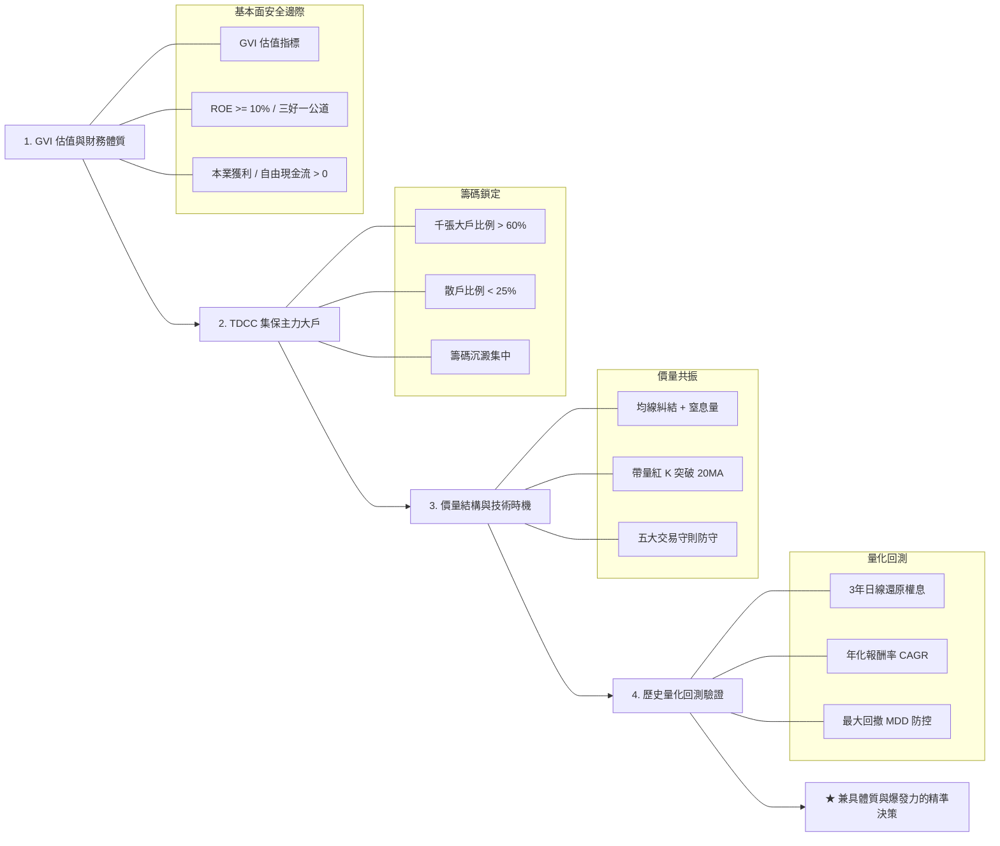

# ⚡ GVI 估值 × 主力籌碼 × 策略回測 全方位整合儀表板

> **一站式決策中心**：本儀表板整合 **TDCC 台灣集中保管結算所** 最新大戶與散戶持股籌碼、**GVI 估值與財務健康體質**、**技術面價量突破** 與 **歷史近 3 年波段量化回測**，免去在多個頁面間反覆切換比對的繁瑣流程，助您一眼看清基本面、籌碼面、時機點與策略勝率！

---

## 綜合儀表板與報表中心

<UnifiedGviDashboard />

---

## 💡 全方位選股四大核心維度

本系統將選股邏輯串聯為一條完整的決策鏈：

### 1. 價值與體質 (GVI + 三好一公道)
* **GVI 成長價值指標**：公式為 $\frac{1}{\text{PB}} \times (1 + \text{ROE})^5$，同時兼顧估值低廉（安全邊際）與長期權益報酬率的高複利成長性。
* **體質嚴選**：剔除本業虧損、過高負債與負自由現金流標的；金融業則自適應評估資本適足率與 ROE。

### 2. 主力籌碼 (TDCC 大戶持股集中度)
* **千張大戶持股比例（分級 15）**：持股佔比超過 60% 代表市場籌碼高度鎖定於董監事、法人與特定實力派主力手中，下跌空間有限。
* **散戶退場（分級 1~9）**：散戶人數持續減少、散戶佔比低於 25%，代表籌碼沉澱洗盤完成，浮額乾淨。

### 3. 技術時機與五大交易守則
* **量縮窒息洗盤（Volume Dry-up）**：股價在糾結均線處量縮整理，代表無主力殺盤拋壓。
* **帶量突破（Volume Expansion Breakout）**：出量 1.6 倍以上突破均線，主力正式表態發動。
* **五大交易紀律**：
  1. 漲破 7% 沒鎖漲停 → 走（防主力衝高出貨）
  2. 低開 3% 站不回紅 → 走（弱勢股不戀棧）
  3. 連漲 3 天 → 先賣一半（保住獲利降風險）
  4. 高檔爆量 → 不問理由走（防高檔換手出貨）
  5. 換手率 <5% → 直接跳過（流動性不足）

### 4. 歷史波段回測機制 (20MA Breakout)
* **進場條件**：股價帶量突破月線（Close > 20MA 且 Vol > 1.2 倍均量）或突破近 20 日高點，且 20MA 走平向上。
* **硬停損機制**：進場後跌幅達到 **-8%** 無條件停損。
* **移動停利**：收盤連續 2 日跌破 20MA 或單日重跌跌破 20MA 超過 2.5% 時平倉。
* **波段鎖利**：獲利達 **+35%** 且跌破 5MA 時部分鎖利落袋。
