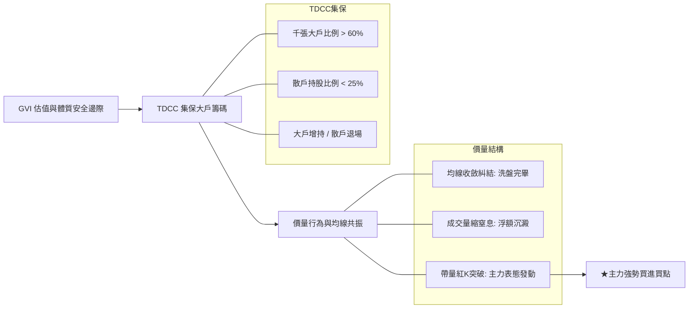

# 主力籌碼 × GVI 雙因子智能選股與回測 Dashboard

> **主力籌碼選股機制**：整合 **台灣集中保管結算所 (TDCC)** 官方千張大戶／400張大戶／散戶人數比例週級數據，結合 **三大法人資金與量價結構（量縮窒息洗盤 vs 帶量突破）**，協助您在基本面體質優良的股票中，提早掌握主力建倉、洗盤與發動的精準買賣時機點！

---

## 主力籌碼可視化總覽

<SmartMoneyCharts />

---

## 1. 主力即時訊號與選股雷達

<CsvTable csvFilePath="Stock_SmartMoney_Signals.csv" :fixedColumns="2" />

---

## 2. 主力策略動態回測績效排行榜

<CsvTable csvFilePath="Stock_SmartMoney_Backtest.csv" :fixedColumns="2" />

---

## 💡 如何找出主力？三大維度解析

根據市場主力操作特徵與集保大戶籌碼結構，本系統定義下列篩選標準：

### 1. 籌碼集中度 (Smart Money 核心)
- **千張超級大戶（分級 15）**：持股佔比超過 60% 代表市場籌碼高度鎖定在董監事、法人與特定實力派大戶手中，下檔支撐極強。
- **散戶退場（100張以下分級 1~9）**：散戶人數持續減少、散戶佔比低於 25%，代表籌碼已從散戶流向少數主力手中（浮額沉澱）。

### 2. 價量結構表態
- **量縮窒息洗盤（Volume Dry-up）**：股價在月線與季線糾結處狹幅震盪，日成交量萎縮至月均量 60% 以下，代表無主力拋壓。
- **帶量突破（Volume Expansion Breakout）**：成交量放大至 1.6 倍以上，突破短中天期糾結均線，主力正式點火上攻。

### 3. 動態波段策略與風控
- **停利**：波段累積漲幅達 18% 或 20 日乖離率達到 15% 時逢高分批獲利了結。
- **停損**：收盤價有效跌破 20MA 超過 3.5% 或自進場點虧損達 -7% 時嚴格執行退場，嚴防主力假突破或反手出貨。
